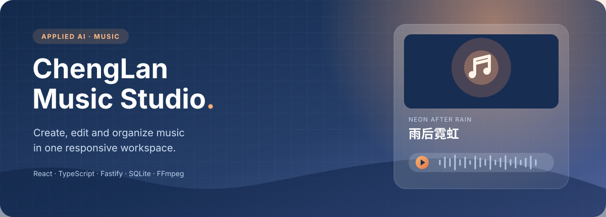
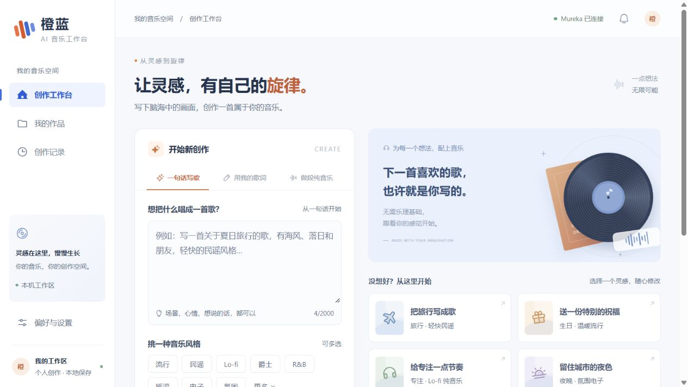
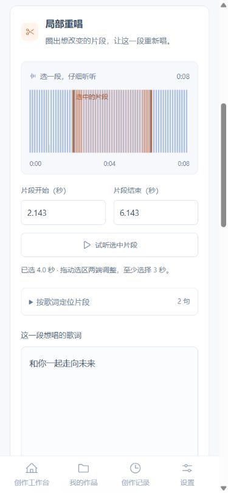
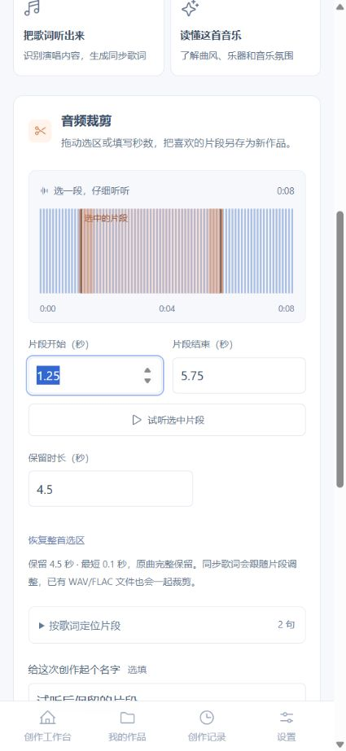
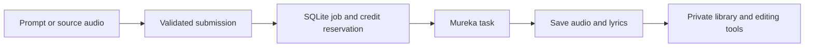

<p align="center"></p>

<p align="center"><b>A music creation workspace built around the Mureka API.</b><br>React · TypeScript · Fastify · SQLite · FFmpeg</p>

<p align="center"><a href="https://github.com/CatAlvin/ChengLan-Mureka-Platform/actions/workflows/verify.yml"></a></p>

<p align="center"><a href="README.zh-CN.md">简体中文</a> · <a href="https://chenglan-mureka-platform.chenglan.tech/demo">Live demo & music</a> · <a href="docs/EVALUATION.md">Evaluation</a> · <a href="spec/README.md">Specifications</a></p>

ChengLan Music Studio turns a prompt, lyrics or an instrumental idea into a saved music project. It connects generation with the work people do afterward: previewing versions, selecting a passage, editing or extending a song, separating stems, reading lyrics and scores, and keeping every artifact in a private library. The browser interface works on desktop and mobile.

## Explore the product

The [public demo](https://chenglan-mureka-platform.chenglan.tech/demo) includes two complete tracks, **雨后霓虹 / Neon After Rain** and **生命赞歌 / Anthem of Life**. Both have playable audio and their original prompts and settings; the latter also has downloadable lyrics and a timed LRC file. The interactive creation and administration flows are safe local simulations, so visitors can explore without an account or an API key.

New songs and instrumentals default to **Mureka V9.5**, with V9 and V8 available in the model picker. Full-song Remix also uses V9.5, accepts a 10–480 second source, and can work with optional replacement lyrics.

<p align="center"></p>

<p align="center"> </p>

## Evidence at a glance

| Check | Observed result | Reproduce |
| :--- | ---: | :--- |
| Automated regression | **129 / 129 tests** across **13 files** | `pnpm test` |
| Same-ID submission replay | **100 requests → 1 job, 1 credit reservation** | `pnpm eval` |
| Audio post-processing | **8,000 ms → 3,000 ms**, source SHA-256 unchanged | `pnpm eval` |
| Format coverage | **4 / 4 formats**: WAV, MP3, FLAC, M4A | `tests/postprocess.test.ts` |
| Real music in public demo | **2 complete tracks** with prompts and saved settings | [Listen](https://chenglan-mureka-platform.chenglan.tech/demo) |

The replay and audio measurements use deterministic local fixtures. The regression suite also covers account isolation, registration approval, quota settlement, restart recovery, media exports and tool workflows. The commands, environment and measurement definitions are in [Evaluation](docs/EVALUATION.md), with [machine-readable results](evaluation/results.json).

## How a song moves through the workspace



The job ID survives a restart. A submission with the same client ID reuses its existing job; a changed payload with that ID is rejected. The worker separates cloud generation from local saving, so a file-save retry can continue from an existing provider result. Audio processing keeps the original file and saves a derived copy; timed lyrics follow the saved duration. See the [architecture notes](docs/ARCHITECTURE.md) for the state and data boundaries.

## What I designed

- **Creation and editing experience:** three entry modes, reusable prompts and drafts, a waveform-based crop and region editor, version comparison, lyrics and score workflows, and responsive navigation.
- **Durable task flow:** queued jobs, provider IDs, restart recovery, bounded polling, explicit retry paths and idempotent submission keys.
- **Private workspaces:** user-scoped tracks, source materials, drafts and downloads; administrator approval, account controls and aggregate usage views.
- **Budget model:** weekly points, a reservation and settlement ledger, and a clear path for charges that need manual verification.

I defined the product concept, overall architecture, interaction flow and acceptance criteria. Implementation and iteration followed written specifications, with AI coding assistance used as part of a spec-driven development workflow. The [specification index](spec/README.md) connects decisions to code and tests; the [project provenance](docs/PROVENANCE.md) records what this public repository contains.

## Run locally

Use Node.js **24.11+**, pnpm **11.25**, and FFmpeg/FFprobe on `PATH`. The public demo runs without a Mureka key.

```bash
git clone https://github.com/CatAlvin/ChengLan-Mureka-Platform.git
cd ChengLan-Mureka-Platform
pnpm install --frozen-lockfile
pnpm build
pnpm start
```

Open [http://127.0.0.1:4173/demo](http://127.0.0.1:4173/demo). For a personal workspace, the first start creates a random administrator password in `deployment-secrets/initial-admin.txt`; the file is excluded from Git. Add `MUREKA_API_KEY` to the server environment when you want to submit real generation tasks. The API key stays on the server.

## Verify

```bash
pnpm lint
pnpm build
pnpm test
pnpm eval
```

| Area | Starting point |
| :--- | :--- |
| React interface and public demo | [`apps/web/src/`](apps/web/src/) |
| Fastify API, auth and task runner | [`apps/server/src/`](apps/server/src/) |
| Shared contracts and point rules | [`packages/shared/src/`](packages/shared/src/) |
| Reproducible scenarios | [`tests/`](tests/) and [`evaluation/`](evaluation/) |
| Design and acceptance criteria | [`spec/`](spec/) |

Mureka supplies the music-generation service; FFmpeg handles local audio processing. The two public demo tracks were created through the platform and are presented as music examples rather than benchmark outputs.
