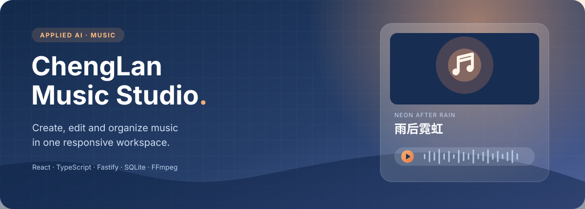
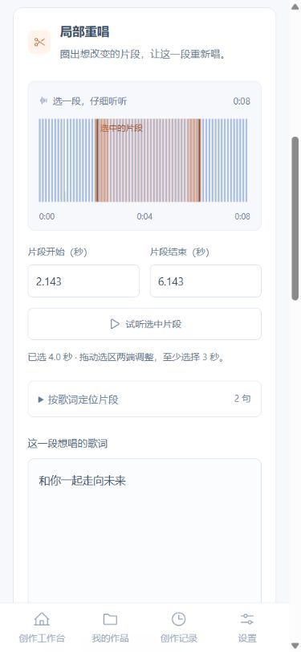
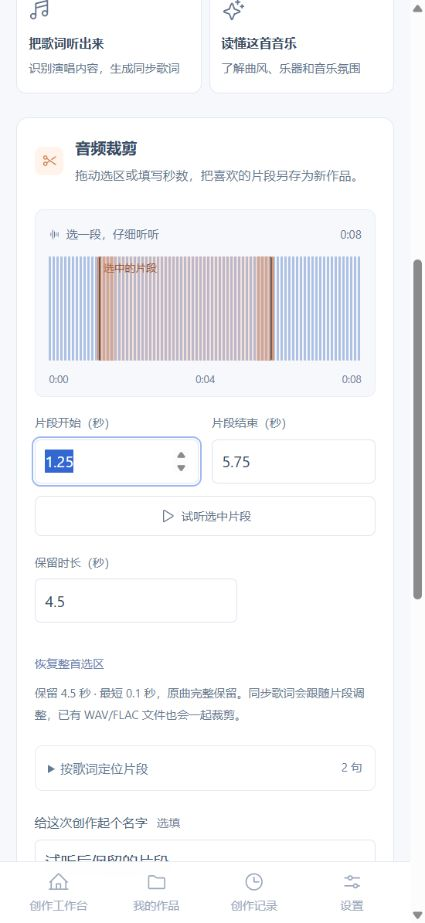

# 橙蓝 AI 音乐工作台

[English](README.md) · [在线演示与试听](https://chenglan-mureka-platform.chenglan.tech/demo) · [评估方法](docs/EVALUATION.md) · [需求规格](spec/README.md)

基于 Mureka API 的音乐创作平台。用户可以从提示词、歌词或纯音乐想法开始，生成后在同一工作区试听、裁剪、续写、局部改编、分轨、查看歌词与乐谱，并整理自己的作品。前端采用 React 与 TypeScript，服务端使用 Fastify、SQLite 和 FFmpeg；桌面与手机均可使用。



## 先看实际作品

[公开演示空间](https://chenglan-mureka-platform.chenglan.tech/demo)展示了《雨后霓虹》和《生命赞歌》两首真实创作，可播放、查看当时的完整提示词和配置，并单独下载音频。《生命赞歌》还提供歌词 TXT 和同步 LRC。访客也能操作模拟创作、后续工具与管理界面，了解一次操作如何进入任务、保存作品和结算点数。


<p align="center"> </p>

## 可复现的结果

| 验证项目 | 本次结果 | 复现方式 |
| :--- | ---: | :--- |
| 自动化回归 | **13 组、128 项全部通过** | `pnpm test` |
| 相同提交标识重复请求 | **100 次请求只形成 1 个任务和 1 条额度预扣** | `pnpm eval` |
| 音频保存处理 | **8 秒 WAV 处理为 3 秒**，原文件 SHA-256 不变 | `pnpm eval` |
| 音频格式回归 | **WAV、MP3、FLAC、M4A 四种格式通过** | `tests/postprocess.test.ts` |
| 公开真实作品 | **2 首可试听**，展示原始输入 | [在线试听](https://chenglan-mureka-platform.chenglan.tech/demo) |

重复提交和音频处理使用确定性的本地测试素材，不产生 Mureka 调用。测试还覆盖用户隔离、注册审批、额度结算、任务恢复、下载与后续创作。指标定义、环境和验证命令见[评估记录](docs/EVALUATION.md)，数据摘要见 [`evaluation/results.json`](evaluation/results.json)。

## 系统设计


创作任务先持久化再交给后台执行；相同提交标识可安全重试，服务重启后可以恢复查询和保存。音频原件与处理后的文件分开保存，歌词 TXT 和具备时间信息的 LRC 随作品关联。用户的作品、素材、草稿与下载按账户隔离；管理员负责注册审批、额度调整和汇总用量。详细分层见[架构说明](docs/ARCHITECTURE.md)。

我负责整体产品思路、架构、交互流程和验收条件。开发按规格文档推进，并使用 AI 编程辅助完成实现与迭代；需求到代码和验证的对应关系见 [`spec/`](spec/README.md)。

## 本机运行

需要 Node.js **24.11+**、pnpm **11.25**、FFmpeg 与 FFprobe。公开演示不需要 Mureka 密钥。

```bash
git clone https://github.com/CatAlvin/ChengLan-Mureka-Platform.git
cd ChengLan-Mureka-Platform
pnpm install --frozen-lockfile
pnpm build
pnpm start
```

打开 [http://127.0.0.1:4173/demo](http://127.0.0.1:4173/demo)。初次启动会在 `deployment-secrets/initial-admin.txt` 生成随机管理员临时密码，该文件不会进入 Git。需要真实创作时，在服务端环境中配置 `MUREKA_API_KEY`。

```bash
pnpm lint
pnpm build
pnpm test
pnpm eval
```

`apps/web/src/` 是页面与交互，`apps/server/src/` 负责 API、鉴权和任务，`packages/shared/src/` 保存共用输入契约与点数规则。公开仓库的内容选择和来源说明见[项目说明](docs/PROVENANCE.md)。
