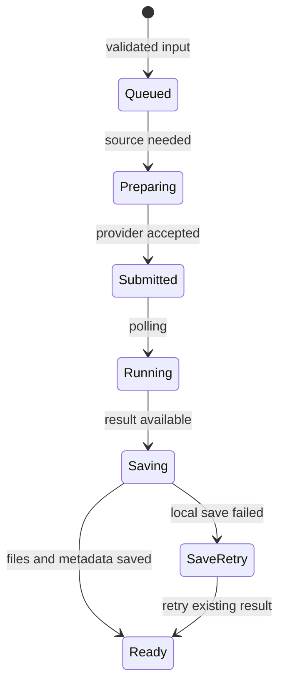

# Architecture

The application keeps the music workflow in one small service. React handles input, playback and editing; Fastify owns identity and job transitions; SQLite records work before the provider is called. FFmpeg prepares and saves audio derivatives on the server.

| Part | Responsibility | Main files |
| :--- | :--- | :--- |
| Web app | Creation forms, private library, waveform controls, public demo | `apps/web/src/app.tsx`, `apps/web/src/components/` |
| Shared contracts | Validated music inputs, tool types and point quotes | `packages/shared/src/` |
| API and identity | Authenticated routes, approvals, sessions, account-scoped access | `apps/server/src/app.ts`, `auth.ts`, `library-routes.ts` |
| Task runner | Provider submissions, polling, recovery and save retries | `apps/server/src/runner.ts` |
| Persistence | Jobs, tracks, sources, sessions, wallets and ledgers | `apps/server/src/db.ts` |
| Media | Safe downloads, local conversion, cropping, lyrics and scores | `apps/server/src/media.ts`, `postprocess.ts`, `creative-audio.ts`, `score-files.ts` |
| Provider adapter | Mureka request and response mapping | `apps/server/src/provider.ts` |

## Submission and recovery

A client-generated submission ID is unique across retries. The API stores the job, draft and initial credit reservation in a SQLite transaction before handing work to the runner. A repeated submission returns the existing job; reuse with changed input returns a conflict. The provider task ID and the current state are persisted so a restarted worker can resume polling or saving. A local save retry uses the existing result rather than generating again.

## Files and ownership

Each track records its owner, source job, provider identity, output formats and processing state. The owner-scoped store controls lists and reads; media and export routes resolve identifiers through that scope before serving a file. Administrator screens expose account management and aggregate usage without making another user's tracks part of the administrator's library.

The original audio is retained as an internal source. A processed copy is saved for playback and download. Lyrics are written as UTF-8 text, with LRC timing when the provider supplies usable timestamps. Crops keep the original track and create a new linked version. WAV and FLAC can be saved alongside MP3 when available from the provider.

## Budget model

The wallet is refreshed at the Monday boundary in Asia/Shanghai. A submission reserves the quoted number of points; completion settles against the outcome. A charge row is unique per job and its ledger records the transition. Unknown upstream cost is held for administrator review rather than inferred from shared account totals. Tests cover weekly rollover, repeated settlement and the final-use rule.

The server reads `MUREKA_API_KEY` at runtime; browser bundles and public demo requests never receive it. Production credentials and user databases are outside the repository.
